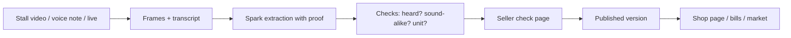

# MarketMate

A market seller films the stall or says today's prices in Tamil, Hindi or English. MarketMate turns that into a checked price list, a shop page, WhatsApp messages, bills and a day close. Prices only ever come from the seller's own voice.

**Built for loose produce sold by weight.** Prices are spoken in Tamil (with Tamil numbers such as "முப்பத்தஞ்சு" = 35 and "கால் கிலோ" = ¼ kg), every price is checked against the seller's own voice clip, and every photo is a real frame from the seller's own video — never a generated image. It is live with two real sellers near Chennai: AK (A.V. Market, Padappai) and VPS (Urapakkam).

**Live:** [https://sivat241--marketmate-web.modal.run](https://sivat241--marketmate-web.modal.run) — pick **Judge demo** to try it in about 3 minutes.

## How to judge (3 minutes)

[https://sivat241--marketmate-web.modal.run](https://sivat241--marketmate-web.modal.run) opens a small entry page — pick **Judge demo**, or go straight to the judge demo at [https://sivat241--marketmate-web.modal.run/try](https://sivat241--marketmate-web.modal.run/try). It makes a private test shop (unlisted, deleted after 7 days) and lands on a light 4-step page — no seller dashboard:

1. **Your stall video or voice note** — upload a clip, or tap "Use a real sample: VPS stall, Tamil, 64 s" to run a real stall video that lives only on the server.
2. **Meta AI at work** — watch `muse-voice-transcribe-1.0` turn speech into text, `muse-spark-1.3` find items, prices and checks, and `sam-3.1` pick a photo for each item.
3. **Price card** — the checked list: tap anything unclear, play the seller's own voice clips, then approve.
4. **Ready** — the WhatsApp catalog message, the Excel sheet (`.xlsx`), and the Meta AI call count and cost for the run.

At most 3 runs per test shop per day; real shops are never touched. The sample video path comes from `JUDGE_SAMPLE_VIDEO` (default `DATA_DIR/samples/judge-sample.mp4`); the file itself is never committed.

## Why

Street and market sellers change prices daily and say them out loud. They do not type catalogues. A buyer wants today's price, not last week's. The seller already speaks every price each morning. MarketMate starts from that spoken moment and keeps proof of it.

## What it does

Not a ledger app: MarketMate turns a market stall's spoken prices into a proof-checked public price list that customers can compare and order from.

1. The seller films the stall or speaks today's prices — a stall video, a voice note, a board photo, or live mode — and Muse Voice + Muse Spark + SAM 3.1 build a proof-checked list. A check page keeps every price's voice-clip proof; the seller taps unclear ones, then approves. Edit names on the check page or later; names are remembered for the next list and for billing. Square item photos: each item is found in the video — sam-3.1 finds its box, and we keep a square original crop from the seller's own video. Whole objects only (a shape test rejects half fruit), cross-checked against the other items and verified by one vision call. If SAM misses the item noun, one fallback re-query with the category noun ("fruit"/"vegetable"/"produce") goes through the same verification. No photo is better than a wrong photo.
2. Approve publishes a version: a WhatsApp catalog message, a shop page with product tiles and today's prices, and a printed price board PDF.
3. Customers compare shops and order by voice, text or photo. Marketplace homepage: hero search, top picks, markets, new shops, and an area chooser. Find a shop: search, open-now chips, and near-me distance computed on the phone. Sellers choose to join ("Show my shop in MarketMate's Find a shop", on for new shops, switch in Settings). The market page has an honest empty state. "My orders" shows status; the seller marks orders packing/ready.
4. The same list runs the seller's whole day: voice and typed billing with UPI QR, an orders board, the credit (udhaar) book with WhatsApp reminders, a day close with wastage and a summary PDF, and an Excel sheet.

Also built (off by default, SHOW_EXTRAS=1): purchases, stock photo counts, helpers, POS CSV, shelf tags.

Example of the printed board (demo data): [docs/img/board.png](docs/img/board.png).

## Honesty by design

Prices only come from the seller's speech. Every price keeps its voice clip. The check page asks the seller when something is unclear (50 vs 80 sound alike in Tamil). Nothing is guessed. Photos are square crops from the seller's own video, never stock or generated, never a face. A script guard catches a wrong-language transcript before any price step runs. One exception: a photo of the seller's own price board can seed prices, but each one stays blocked until the seller taps it.

## Meta models used

| Model id | What it does here | Where in the code |
|---|---|---|
| `muse-voice-transcribe-1.0` | File transcription: stall video, voice notes, quote, bill and market voice | `app/meta/transcribe.py` |
| `muse-voice-transcribe-1.0` | Live transcription over websocket: live prices, live billing, live ordering | `app/meta/realtime.py` |
| `muse-spark-1.3` | Text: price extraction, voice updates, purchases, number cross-check, search parse, basket explanation | `app/pipeline/extract.py`, `app/pipeline/update.py`, `app/pipeline/purchase.py`, `app/pipeline/checks.py`, `app/market/search.py`, `app/market/basket.py` |
| `muse-spark-1.3` | Vision: product list, best frame per item, board reading, photo quotes | `app/pipeline/vision.py`, `app/pipeline/frames.py`, `app/pipeline/board.py`, `app/market/quote.py` |
| `sam-3.1` | Item boxes for the square crops, face gate, counting boxes (parsed with `meta-sam-parser`) | `app/pipeline/photos.py`, `app/pipeline/vision.py`, `app/meta/sam.py` |
| `meta-models/muse-spark-open-1026` | Optional: the text steps above via Baseten when `TEXT_PROVIDER=baseten` | `app/meta/spark.py`, `app/config.py` |

One Spark id (`muse-spark-1.3`) serves every text and vision step. Image steps always use Meta. The number cross-check uses Baseten whenever a key is set, else Meta. No runtime model from any other company is used.

## Meta AI calls

Every Meta model call is logged with its model, step, latency and cost, per shop. The owner-only "Meta AI calls" page — linked from the More menu on the seller home and from each session page — lists every call with today's totals: the proof behind the demo.

## How it works



The app stores everything in SQLite. An approved list is a version. Items hang off the version, price lines off the items. The `quotes` table holds customer quotes and seller bills (told apart by kind). Drafts hold the unapproved check page. Every Meta call logs its cost to a separate ledger file. A daily cap (`DAILY_BUDGET_USD`, default 3) stops new calls when spent.

## Languages

The UI speaks English, Tamil and Hindi, with English fallback. Voice input accepts all 25 languages in `app/languages.py`: transcription is biased to the shop language plus English. Number proof is strongest in English, Tamil and Hindi; other languages get a model cross-check on unclear numbers. Sound-alike guards cover Tamil, Hindi, Marathi, Bengali, Mandarin and Thai. A synthetic benchmark (not real market audio) is in `docs/languages.md`.

## Run it locally

Prerequisites: Python 3.12 or newer, `ffmpeg`, and the WeasyPrint system libraries (Pango; the Linux list is in `modal_app.py`).

```bash
python -m venv .venv && .venv/bin/pip install -e .
```

Copy `.env.example` to `.env` and set the keys by name: `MODEL_API_KEY` (your Meta Model API key), optional `BASETEN_API_KEY`, `TEXT_PROVIDER`, `DATA_DIR`. Then start the server:

```bash
.venv/bin/uvicorn app.web.main:app
```

Open `http://127.0.0.1:8000`.

Run the tests (needs the dev extras and a key in `.env`):

```bash
PYTHONPATH=$PWD .venv/bin/pytest -q
```

2126 tests pass. `.venv/bin/ruff check .` is clean.

## Sample shops

Five labelled sample shops keep the site from looking empty: Selvi
Vegetable Stall (Koyambedu, Chennai), Pandian Fruit Centre
(Mattuthavani, Madurai), Amma Keerai Kadai (R.S. Puram, Coimbatore),
Gupta Sabzi Wale (Azadpur Mandi, Delhi) and Green Basket (Russell
Market, Bengaluru). Every one is always labelled "Sample shop", shows
"Sample prices" instead of "said today", sorts after real shops, and
has no phone number or UPI id — orders to them are clearly marked as
tests nobody will pack.

Their prices really went through the Meta pipeline: each list was
spoken as a voice note and processed by Muse Voice Transcribe, Muse
Spark and the same checks as an uploaded voice note, and each item
photo went through the same SAM 3.1 square crop + Spark photo check.
Re-seeding costs nothing and makes no API calls — the pipeline output
is committed in `scripts/sample_data/`.

```sh
PYTHONPATH=$PWD .venv/bin/python scripts/seed_samples.py            # seed
PYTHONPATH=$PWD .venv/bin/python scripts/seed_samples.py --remove   # delete
SAMPLE_SHOPS=0  # hide them everywhere without deleting
```

Photo credits for all 63 sample images are in
[docs/photo-credits.md](docs/photo-credits.md) (Unsplash License).
Real sellers can upload their own stall photo under Settings →
"Shop photo".

## Deploy

See [docs/deploy.md](docs/deploy.md) for the Modal deploy. The app runs as one container with a persistent volume for the database, photos, clips and cost ledger. Secrets come from a Modal secret built from `.env`. It scales to zero after 20 idle minutes and the daily budget cap still applies. The web app keeps one warm container (min_containers=1); set it to 0 in modal_app.py to turn it off.

## Privacy

Stored on disk: the SQLite database, item photos, voice clips and the cost ledger. Voice recordings go to Meta's API for transcription; the app says so on every voice screen. The customer's location never leaves the phone: near-me distance is computed in the browser with no network calls. The shop location is optional and stored rounded to about 100 m. Faces are never published: frames blocked by a face get no photo, and faces in seller retakes are blurred.

## How it was built

Every commit in this repository was made by Muse Code, Meta's coding agent. 215 of 216 commits carry the `Built-with: Muse Code` trailer (the one without it is a 3-line docs commit). Built during the hackathon building period, 27 Oct – 4 Nov 2026.

Logo: the MarketMate "Mm leaves" mark (teal green + soft blue) and wordmark were drawn in code by Muse Code — see [docs/brand.md](docs/brand.md).

Design: v13 teal green + soft blue marketplace (#0F766E, #0369A1) — [docs/ui/v11-meta-blue-accent.md](docs/ui/v11-meta-blue-accent.md) is an earlier theme note.

Icons: Fluent Emoji (Flat) by Microsoft, MIT licence.

Photos: the five landing-page photos are by Frédéric Barriol, Ashwini Chaudhary (Monty), Aditya Sethia, Abdullah Azeez and Emil Widlund, via Unsplash — see [docs/photo-credits.md](docs/photo-credits.md).

Font: Inter (SIL Open Font License 1.1, OFL) for English text; Noto keeps Tamil and Hindi — see [docs/fonts.md](docs/fonts.md).

## Limits and next steps

- Spark results vary between runs, so the check page exists and every price needs proof.
- SAM can confuse similar fruit, so each crop is verified before it ships.
- Tamil and Hindi strings are complete but still await native-speaker review.
- The language benchmark uses synthetic clips, not real market recordings.
- One container owns the SQLite database; scaling past that needs a real database.
