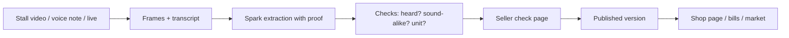

# MarketMate

A market seller films the stall or says today's prices in Tamil, Hindi or English. MarketMate turns that into a checked price list, a shop page, WhatsApp messages, bills and a day close. Prices only ever come from the seller's own voice.

## Why

Street and market sellers change prices daily and say them out loud. They do not type catalogues. A buyer wants today's price, not last week's. The seller already speaks every price each morning. MarketMate starts from that spoken moment and keeps proof of it.

## What it does

Seller:

- Morning prices from a stall video, a voice note, a board photo, or live mode.
- A check page where every price keeps its voice-clip proof. The seller taps unclear ones, then approves.
- Approve publishes a version: shop page, WhatsApp price message, price board PDF, shelf tags, CSV and Excel.
- Edit names on the check page or later. Names are remembered for the next list and for billing.
- Cut-out photos: whole objects only (a shape test rejects half fruit), cross-checked against the other items' masks and verified by one vision call. If SAM misses the item noun, one fallback re-query with the category noun ("fruit"/"vegetable"/"produce") goes through the same verification. No photo is better than a wrong photo.

Billing:

- Voice or typed bills from today's list. Tap items for the fastest no-AI path.
- UPI QR on the bill and a cash change helper.
- Credit (udhaar) with customer balances and WhatsApp reminders.
- Orders board: quotes waiting, bills, paid. Day close with wastage and a summary PDF.

Customer:

- Marketplace homepage: hero search, top picks, markets, new shops, and an area chooser.
- Shop page with product tiles and today's prices.
- Order by voice, text or photo. "My orders" shows status.
- Find a shop: search, open-now chips, and near-me distance computed on the phone. Sellers choose to join ("Show my shop in MarketMate's Find a shop", on for new shops, switch in Settings). The market page has an honest empty state.

Example of the printed board (demo data): [docs/img/board.png](docs/img/board.png).

## Honesty by design

Prices only come from the seller's speech. Every price keeps its voice clip. The check page asks the seller when something is unclear (50 vs 80 sound alike in Tamil). Nothing is guessed. Photos are the seller's own frames with the background removed, never stock or generated, never a face. A script guard catches a wrong-language transcript before any price step runs. One exception: a photo of the seller's own price board can seed prices, but each one stays blocked until the seller taps it.

## Meta models used

| Model id | What it does here | Where in the code |
|---|---|---|
| `muse-voice-transcribe-1.0` | File transcription: stall video, voice notes, quote, bill and market voice | `app/meta/transcribe.py` |
| `muse-voice-transcribe-1.0` | Live transcription over websocket: live prices, live billing, live ordering | `app/meta/realtime.py` |
| `muse-spark-1.3` | Text: price extraction, voice updates, purchases, number cross-check, search parse, basket explanation | `app/pipeline/extract.py`, `app/pipeline/update.py`, `app/pipeline/purchase.py`, `app/pipeline/checks.py`, `app/market/search.py`, `app/market/basket.py` |
| `muse-spark-1.3` | Vision: product list, best frame per item, board reading, photo quotes | `app/pipeline/vision.py`, `app/pipeline/frames.py`, `app/pipeline/board.py`, `app/market/quote.py` |
| `sam-3.1` | Cut-out masks, face gate, counting boxes (parsed with `meta-sam-parser`) | `app/pipeline/photos.py`, `app/pipeline/vision.py`, `app/meta/sam.py` |
| `meta-models/muse-spark-open-1026` | Optional: the text steps above via Baseten when `TEXT_PROVIDER=baseten` | `app/meta/spark.py`, `app/config.py` |

One Spark id (`muse-spark-1.3`) serves every text and vision step. Image steps always use Meta. The number cross-check uses Baseten whenever a key is set, else Meta. No runtime model from any other company is used.

## Meta AI calls

Every Meta model call is logged with its model, step, latency and cost, per shop. The owner-only "Meta AI calls" page — linked from the More menu on the seller home and from each session page — lists every call with today's totals: the proof behind the demo.

## How it works



The app stores everything in SQLite. An approved list is a version. Items hang off the version, price lines off the items. The `quotes` table holds customer quotes and seller bills (told apart by kind). Drafts hold the unapproved check page. Every Meta call logs its cost to a separate ledger file. A daily cap (`DAILY_BUDGET_USD`, default 3) stops new calls when spent.

## Languages

The UI speaks English, Tamil and Hindi, with English fallback. Voice input accepts all 25 languages in `app/languages.py`: transcription is biased to the shop language plus English. Number proof is strongest in English, Tamil and Hindi; other languages get a model cross-check on unclear numbers. Sound-alike guards cover Tamil, Hindi, Marathi, Bengali, Mandarin and Thai. A synthetic benchmark (not real market audio) is in `docs/languages.md`.

## Run it locally

Prerequisites: Python 3.12 or newer, `ffmpeg`, and the WeasyPrint system libraries (Pango; the Linux list is in `modal_app.py`).

```bash
python -m venv .venv && .venv/bin/pip install -e .
```

Copy `.env.example` to `.env` and set the keys by name: `MODEL_API_KEY`, optional `BASETEN_API_KEY`, `TEXT_PROVIDER`, `DATA_DIR`. Then start the server:

```bash
.venv/bin/uvicorn app.web.main:app
```

Open `http://127.0.0.1:8000`.

Run the tests (needs the dev extras and a key in `.env`):

```bash
PYTHONPATH=$PWD .venv/bin/pytest -q
```

1659 tests pass. `.venv/bin/ruff check .` is clean.

## Deploy

See [docs/deploy.md](docs/deploy.md) for the Modal deploy. The app runs as one container with a persistent volume for the database, photos, clips and cost ledger. Secrets come from a Modal secret built from `.env`. It scales to zero after 20 idle minutes and the daily budget cap still applies.

## Privacy

Stored on disk: the SQLite database, item photos, voice clips and the cost ledger. Voice recordings go to Meta's API for transcription; the app says so on every voice screen. The customer's location never leaves the phone: near-me distance is computed in the browser with no network calls. The shop location is optional and stored rounded to about 100 m. Faces are never published: frames blocked by a face get no photo, and faces in seller retakes are blurred.

## How it was built

Every commit in this repository was made by Muse Code, Meta's coding agent. 92 of 93 commits carry the `Built-with: Muse Code` trailer (the one without it is a 3-line docs commit). Built during the hackathon building period, 27 Oct – 4 Nov 2026.

Logo: the MarketMate "Mm leaves" mark (Meta blue + green) and wordmark were drawn in code by Muse Code — see [docs/brand.md](docs/brand.md).

Design: v11 Meta blue accent (#0866FF, #0064E0) — see [docs/ui/v11-meta-blue-accent.md](docs/ui/v11-meta-blue-accent.md).

Icons: Fluent Emoji (Flat) by Microsoft, MIT licence.

Photos: the five landing-page photos are by Frédéric Barriol, Ashwini Chaudhary (Monty), Aditya Sethia, Abdullah Azeez and Emil Widlund, via Unsplash — see [docs/photo-credits.md](docs/photo-credits.md).

Font: Inter (SIL Open Font License 1.1, OFL) for English text; Noto keeps Tamil and Hindi — see [docs/fonts.md](docs/fonts.md).

## Limits and next steps

- Spark results vary between runs, so the check page exists and every price needs proof.
- SAM can confuse similar fruit, so each cut-out is verified before it ships.
- Tamil and Hindi strings are complete but still await native-speaker review.
- The language benchmark uses synthetic clips, not real market recordings.
- One container owns the SQLite database; scaling past that needs a real database.
